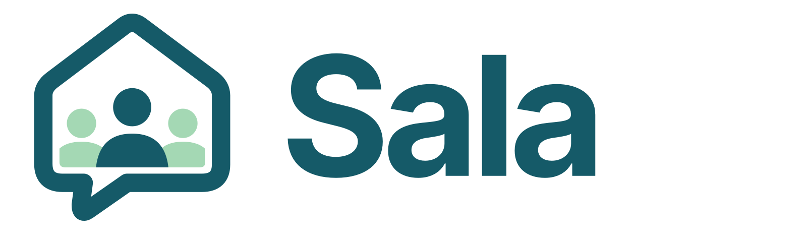
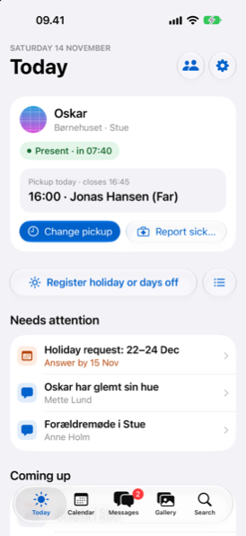
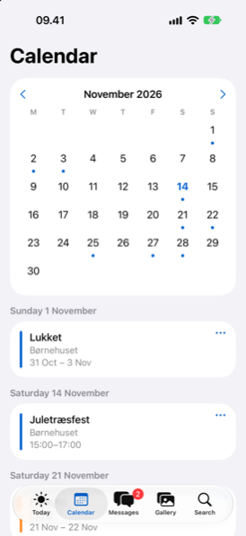
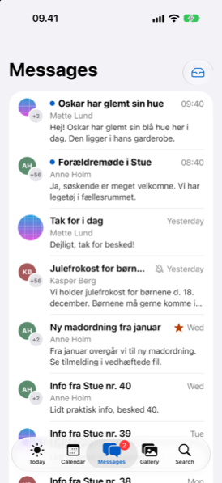
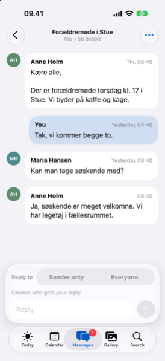

<p align="center">
  <picture>
    <source media="(prefers-color-scheme: dark)" srcset="assets/sala_full_dark.png">
    
  </picture>
</p>

<p align="center">An unofficial iOS app for <a href="https://www.aula.dk">Aula</a>, the Danish school and daycare platform.</p>

> [!WARNING]
> Sala is a work in progress and very much vibe coded. It comes with no guarantees of any kind: use it at your own risk.
>
> Sala may not be sold, rented or used commercially. See [License](#license).
>
> Sala is an independent hobby project. It is in no way associated with, affiliated with, endorsed by or supported by Aula, KOMBIT, Netcompany, MitID, the Danish Agency for Digital Government, the municipalities, schools or daycares that use Aula, or anyone else.

<p align="center">
  
  
  
  
</p>

<p align="center"><sub>Screenshots from <a href="#demo-mode">demo mode</a>: every name and message is invented.</sub></p>

## What it does

- **Today**: each child's status (present, sick, gone home, ...), pickup time and who picks up, closing time, holiday requests and messages that need an answer, upcoming events and posts.
- **Pickup and sick**: set the pickup time, report a child sick.
- **Holidays**: register holidays and days off, change or cancel them, and answer the institution's holiday requests (and change an answer until the deadline).
- **Calendar**: Aula's calendar, optionally synced to the iOS Calendar.
- **Messages**: threads, replies (to everyone or only the sender), and your own folders.
- **Gallery**: albums with their photos and videos; save either to Photos.
- **Search**: Aula's search across messages, posts and photos, from the search button in the tab bar.
- **Contacts**: Aula's contact book for each child's groups, from the button next to Settings on Today, with call, text, e-mail and Add to Contacts.
- **Translate and summarize** (off by default): a Translate or Summarize button on each message and post, into the iPhone's language. Settings → AI picks where it runs: Apple's model on the phone (nothing leaves it), or your own OpenAI-compatible endpoint or Anthropic API key. The prompts are editable.
- **Widget**: status, pickup time and closing time on the Home Screen.
- **Shortcuts and Siri**: today's status, unread messages, set pickup time, report sick (asks first), and open Today, Messages or Calendar. Say "When is pickup today in Sala" or "Unread messages in Sala". Setting pickup and reporting sick need the phone unlocked; with Lock with Face ID on, so does everything else. With no Aula session they say "Open Sala to log in" and never start MitID.

Sala has no server. The app talks to Aula directly from the phone, and you log in with MitID inside the app. Your Aula session stays in the device's Keychain.

The Aula calls began as a Swift port of a small Python server built on [`aula`](https://github.com/nickknissen/aula) (`nickknissen/aula`), a Python API wrapper for Aula. Thanks to its authors for working out how Aula's API behaves. Aula has no public API: Sala uses the same private API as Aula's own app and web portal, and logs in as Aula's app does, so it may break whenever Aula changes, and using it may go against Aula's terms.

## Building

Requires Xcode with the iOS 27 SDK (the app needs iOS 27) and [XcodeGen](https://github.com/yonaskolb/XcodeGen).

1. Copy `ios/Config/Local.example.xcconfig` to `ios/Config/Local.xcconfig` (gitignored) and set your `DEVELOPMENT_TEAM` and a `SALA_BUNDLE_ID` your team can register. A free personal team works: the app and widget share data through a keychain access group, not an app group. Running the app in the simulator needs this too, since an unsigned build has no Keychain access. The tests don't.
2. Open `ios/Sala.xcodeproj` and run, or install on a connected phone with `ios/scripts/install-device.sh "<device name>"`.

### Demo mode

A debug build launched with `-demo YES` (Xcode: Product → Scheme → Edit Scheme → Run → Arguments) skips the login and runs on a fake Aula with invented data from `ios/DemoAula/`. Everything but the network is real: routes, mapping, views. Dates follow today. Writes (pickup, sick, replies, folders) succeed but change nothing, so a reload shows the old state; creating a folder fails, since the fake can't show the new one. Log out leads to a "Back to demo data" button, never MitID. Use it in the simulator: on a phone, demo data also reaches the widget and the Sala calendar. Add `-demoOpenPhoto YES` to start in the photo viewer. The fixtures are not in Release builds.

`ios/project.yml` is the source of truth for the Xcode project. `ios/Sala.xcodeproj` is generated from it and committed, so run `xcodegen generate` in `ios/` after changing the spec.

## Tests

```sh
cd ios && xcodebuild test -project Sala.xcodeproj -scheme Sala -destination 'platform=iOS Simulator,name=<an iPhone simulator>'
```

`SalaUITests` drive the demo app in the simulator; `PhotoViewerTests` checks that a photo stays centred as the viewer's bars hide and show.

`DemoTests` fail when the app calls an Aula method that has no fixture in `ios/DemoAula/`, when a fixture's method is no longer called, or when a screen's route can't be answered from the fixtures.

## Security

Report vulnerabilities privately, and never post real Aula data in issues: see [`SECURITY.md`](SECURITY.md).

## Docs

- [`API.md`](API.md): the in-app routes between the views and Aula.
- [`docs/aula-shapes/`](docs/aula-shapes/): where fields sit in Aula's responses, the structure and field types of real responses, with no values.

## License

[PolyForm Noncommercial 1.0.0](LICENSE). You may use, change and share Sala for noncommercial purposes only. You may not sell it, rent it, charge for access to it, or use it in any other commercial way. Commercial rights are reserved to the copyright holder.

Sala includes work by others under their own licenses: see [`THIRD_PARTY_NOTICES.md`](THIRD_PARTY_NOTICES.md).
